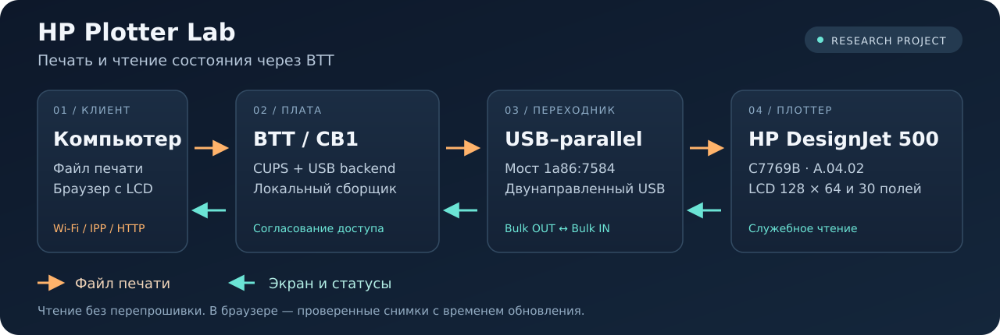
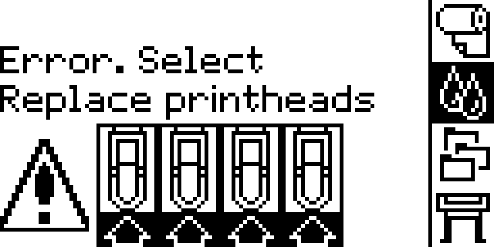
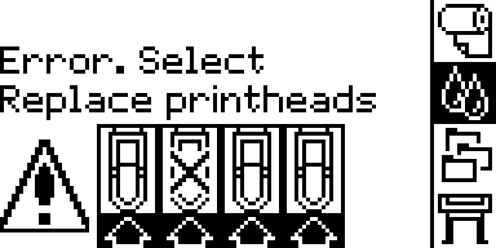

<div align="center">

# HP Plotter Lab

**HP DesignJet 500 + BTT: печать по сети, экран и диагностика через USB–parallel.**

[](docs/quickstart.md) [](docs/btt.md) [](docs/monitor.md) [](docs/validation.md)

[Начать](docs/quickstart.md) · [Веб-просмотр](docs/monitor.md) · [Результаты](docs/validation.md) · [Документация](docs/README.md)

</div>



Старый плоттер можно подключить к Linux-плате BTT и отправлять на него задания по сети. Этот проект также получает **настоящий LCD, 30 основных и 14 дополнительных служебных полей HP** через тот же USB–parallel мост. Для чтения не требуется менять прошивку плоттера или переустанавливать Klipper на плате.

Здесь собраны исходники, локальный веб-просмотр, согласование с CUPS, инструменты анализа печатного потока и инструкции для повторения результата.

## Что уже получилось

| Возможность | Состояние |
| --- | --- |
| Полный LCD **128 × 64**, включая мигающие значки | Получены и проверены оба буфера на реальном плоттере |
| **30 основных + 14 дополнительных полей** | Прочитаны отдельными проверенными планами; значения сохраняются без выдуманных единиц |
| **Системный журнал HP** | Прочитано кольцо из 10 событий: код, модуль и строка; даты не подтверждены |
| **История четырёх цветов головок** | Прочитаны все слоты; маска текущего Black совпала с ODB, из неё получен код 0033 |
| Просмотр в браузере | Работает на BTT; показывает снимок, возраст и итог последнего опроса |
| Самостоятельный сбор на BTT | Управляющий компьютер и SSH во время сбора не нужны |
| Согласование опроса и печати | Опрос уступает заданиям; проверены сохранность байтов и остановка при сбоях |
| Длительная устойчивость USB–parallel | **Не доказана:** после девяти полных циклов прежний способ снова дал тайм-аут; новый способ проверяется отдельно |
| Качество физической печати | **Не принято:** ошибка чёрной головки и прежняя рябь не объявлены исправленными |

Проверенная связка — **C7769B / firmware A.04.02 / мост 1a86:7584**. Совместимость исследовательского проекта ограничена этой проверенной связкой. [Подробные результаты и границы проверки →](docs/validation.md)

## Экран самого HP

<table>
<tr>
<th>Основной буфер</th>
<th>Вторая фаза мигания</th>
</tr>
<tr>
<td></td>
<td></td>
</tr>
</table>

Это сохранённые примеры реального чтения. На них HP просит заменить головку. Веб-просмотр показывает время своего последнего снимка: **это не видеопоток**, а последовательное чтение памяти LCD. Полный сбор занимал около 9–10 минут; отдельный новый способ прошёл за 8 минут 24 секунды. [Как устроено чтение →](docs/protocol.md)

## С чего начать

| Задача | Куда идти |
| --- | --- |
| Подключить BTT и настроить сетевую печать | [Плата, CUPS, рулон 610 мм](docs/btt.md) |
| Видеть LCD и состояния в браузере | [Локальные службы и согласование доступа](docs/monitor.md) |
| Проверить новый способ обмена с одним USB-сеансом | [Batch, дополнительные статусы и журнал](docs/batch.md) |
| Снять экран или статусы разово через SSH | [Быстрый старт](docs/quickstart.md) |
| Проверить, меняет ли программный тракт картинку | [RIP, PCL3GUI и Mode 10](docs/raster.md) |
| Разобраться в сервисном протоколе и firmware | [Протокол](docs/protocol.md) · [Офлайн-анализ firmware](docs/firmware.md) |
| Понять, что доказано и что осталось | [Результаты проверки](docs/validation.md) |
| Понять причину ошибки и границы удалённого доступа | [Коды, журналы и карта возможностей](docs/capabilities.md) |

### Установить инструменты на управляющий компьютер

```bash
git clone https://github.com/artemygroshev/hp-plotter.git
cd hp-plotter
python3 -m venv .venv
. .venv/bin/activate
python -m pip install -r requirements.txt
make test
```

Это офлайн-проверки, они не обращаются к плоттеру. Дальше заполните локальную конфигурацию и подготовьте BTT по [пошаговой инструкции](docs/quickstart.md). Локальному сборщику и веб-серверу достаточно стандартной библиотеки Python; Pillow и NumPy на BTT для них не нужны.

### Выбрать нужный режим чтения

После настройки доступа задайте разрешённый дедлайн в ISO8601 с часовым поясом в переменной `DEADLINE`. Пример команд:

```bash
# Экран, две проверочные копии и мигающие значки
python tools/service/designjet_readonly.py screen --passes 2 --include-blink --until-utc "$DEADLINE"

# Экран и все 30 полей
python tools/service/designjet_readonly.py all --passes 2 --include-blink --until-utc "$DEADLINE"
```

Есть отдельные режимы `status` и `heads`. Сырые ответы, JSON, BIN и PNG сохраняются приватно; каталог можно задать через `capture_root`.

## Как разделены задачи

**Печать:** клиент → IPP/CUPS на BTT → отдельная обвязка → штатный USB backend → переходник → HP. Обвязка сохраняет байты задания и согласует доступ с опросом.

**Наблюдение:** служба на BTT → короткие служебные запросы HP → проверка идентичности, меток и полноты → сохранённый LCD/JSON → браузер. Состояние CUPS `idle` не подменяет сообщение Ready на экране плоттера.

| Каталог | Назначение |
| --- | --- |
| [`tools/service/`](tools/service/) | Чтение, monitor, веб-сервер, общий lock/guard и CUPS-обвязка |
| [`tools/raster/`](tools/raster/) | Разбор PCL3GUI и сравнение выходов фильтров |
| [`tools/firmware/`](tools/firmware/) | Офлайн-анализ HP, протокол и низкоуровневые эксперименты |
| [`deploy/`](deploy/) | Systemd units и пустые шаблоны настроек |
| [`docs/`](docs/README.md) | Установка, устройство проекта, результаты и первичные источники |
| [`examples/`](examples/) | Проверенные примеры LCD |

## Проверки и текущая граница

**174 офлайн-проверки**, включая ошибки транспорта, частичный OUT без повтора, полноту LCD, nonce, конфигурацию, оба журнала и согласование процессов. На BTT отдельно прошли 8 процессных, 10 проверок состояния и 30 проверок batch/журналов/веб-кэша. Проверки с официальными firmware требуют внешних файлов HP; без них пять проверок явно пропускаются. В браузере прошли 9 сценариев отображения и отказов.

Ночная проверка продолжается с отдельным учётом новых способов. Успешный снимок и правильный программный растр подтверждены; безотказность всего тракта и качество отпечатка — отдельные критерии. При неопределённой передаче служба сохраняет исходные данные и останавливает новые операции. [Протокол проверки →](docs/validation.md)

В репозитории нет паролей, ключей, заполненной конфигурации, истории чатов, рабочих журналов или образов HP/Windows. Прошивки и внешние библиотеки получают отдельно из [первичных источников](docs/sources.md). Основной клиент читает состояние; он не нажимает кнопки панели и не запускает flash или обслуживание.
